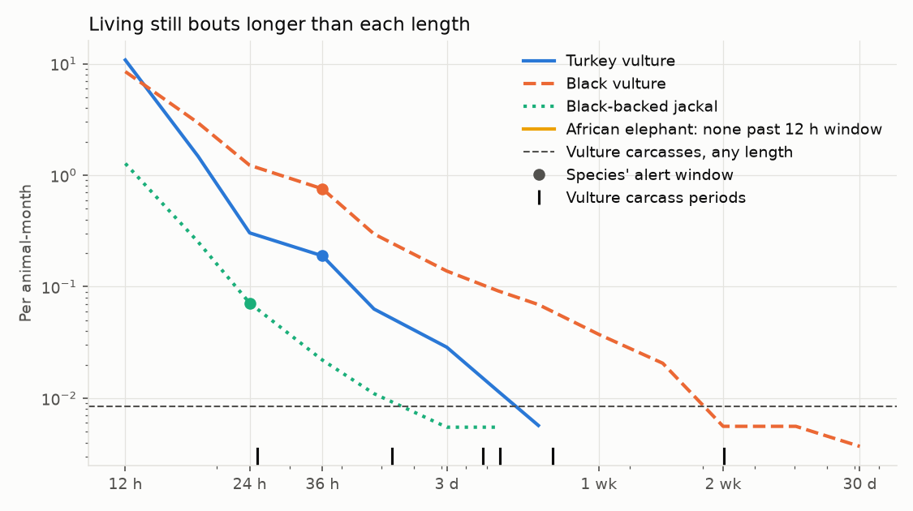
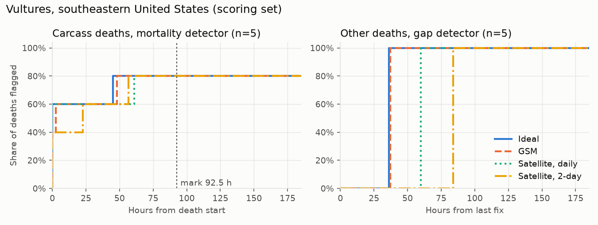
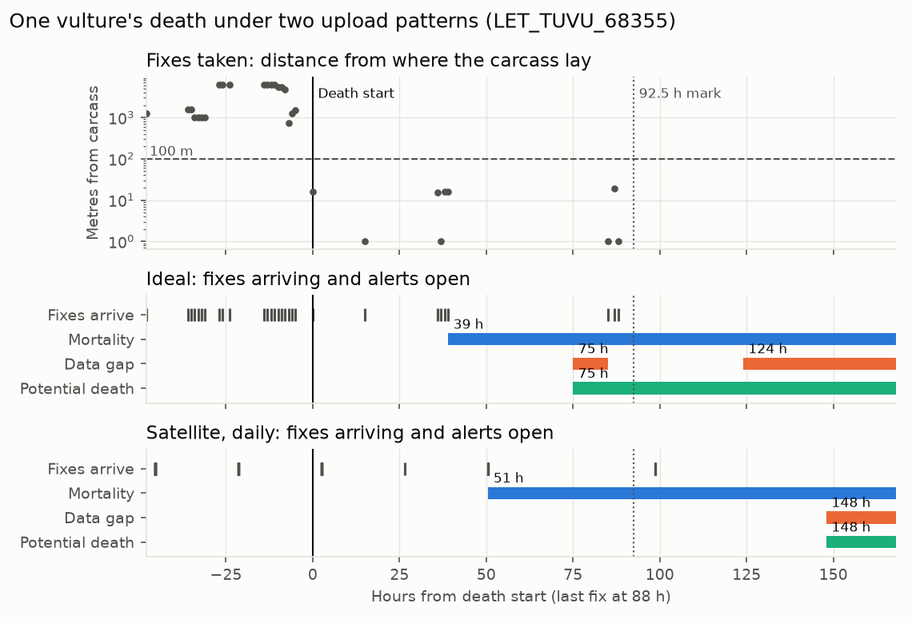
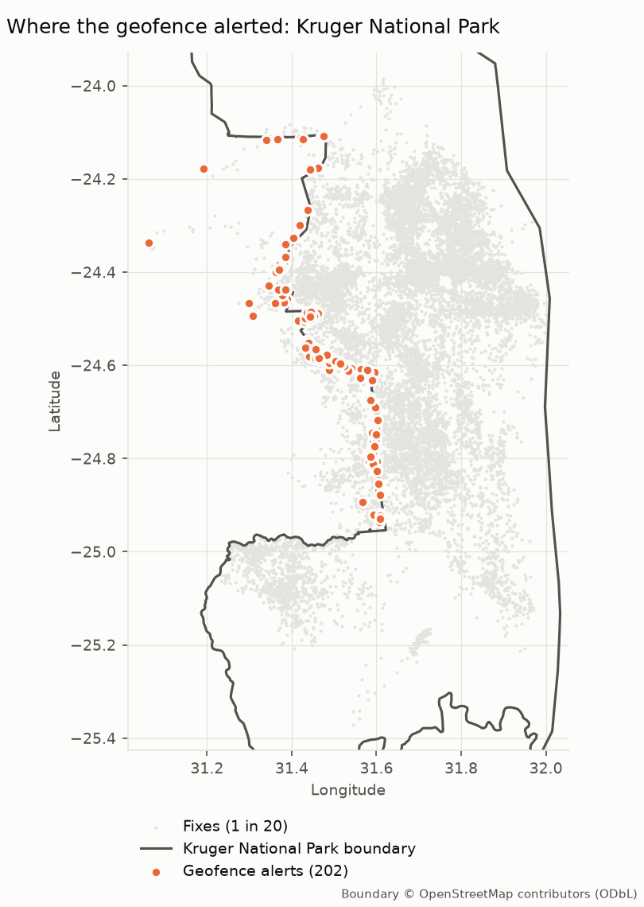
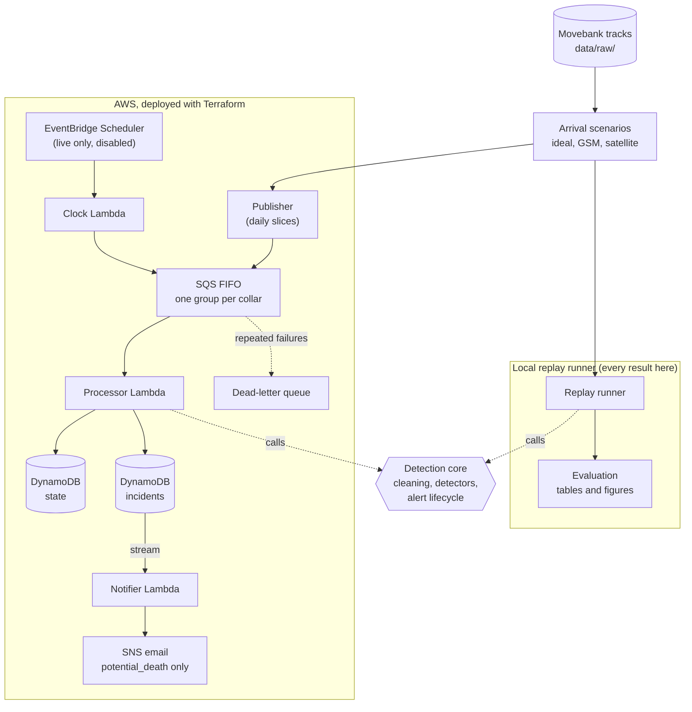
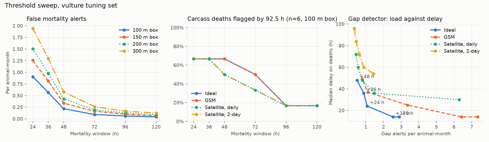

# Collar Telemetry
[](https://github.com/benmacp123/collar-telemetry/actions/workflows/main.yml)

An alerting pipeline for wildlife GPS collars. It turns raw, late and
duplicated fixes into alerts for possible deaths, silent collars, unusual
movement and park-boundary crossings, and is scored against real recorded
deaths in public Movebank data.

## The question

Can a small, cheap pipeline turn raw GPS-collar fixes into alerts a ranger
can trust, without drowning them in false alarms?

Protected-area teams receive collar fixes that arrive late, out of order,
twice or not at all. The useful product is not the data but the alert:
raised quickly, raised once, and right often enough to act on.

## The answer so far

**Every recorded death raises an alert, but GPS stillness alone cannot
say an animal is dead.** On held-out vultures (23 deployments, 491
animal-months, 10 recorded deaths; thresholds frozen on an earlier set,
though this set has since been looked at again, see
[Limitations](#limitations)):

| | Ideal arrival | Daily satellite upload |
|---|---|---|
| Deaths that raised an alert | 10 of 10 | 10 of 10 |
| Carcasses flagged by the mortality detector within 92.5 h | 4 of 5 | 4 of 5 |
| Deaths with no carcass period (collar stops) flagged by the gap detector | 5 of 5, at 36 h | 5 of 5, at 60 h |
| All alerts per animal-month | 1.1 | 0.9 |
| Mortality alerts that were real deaths | 3.1% | 3.1% |
| Mortality alerts that were real deaths or tag events | 4.1% (1.5-10%) | 4.1% (1.5-10%) |
| Best a stillness alert could do at that false-alert rate (ceiling) | 2.6% | 2.6% |
| "Potential death" alerts that were real deaths | 27% (8.1-77%) | 40% (14-80%) |

Brackets are 95% intervals from resampling whole birds. The mortality
alert's precision is not a tuning failure; it is set by arithmetic. The
held-out set has one carcass per 98 animal-months and the alert raises
0.38 false alerts per animal-month, so a detector that fired exactly once
on every carcass would still be right only 2.6% of the time (the
*ceiling*). The false alerts are living birds resting: on the tuning set,
still bouts longer than the 36 h window come about 70 times as often as
carcasses (0.61 against 0.0085 per animal-month), 17 of them lasted over
a week, and black vultures sit still for that long four times as often
as turkey vultures. No window or box in the sweep, up to 120 h and 300 m,
gets above 6% real deaths on the tuning set
([`results/sweep/SWEEP.md`](results/sweep/SWEEP.md)). Even an alert on
every silent collar does better, at 5.9%.



For a programme tracking 30 vultures, all alert types together come to
about one a day; the mortality alert alone is about 0.4 a day, nearly all
false. The "potential death" alert (still, then silent) is 9 to 14 times
as precise as the mortality alert on this set (8 times under GSM uploads),
but that is a point estimate: with five carcasses the intervals allow anything from about 2
to 35 times. It also catches no death the other alerts miss, and usually
comes once a carcass collar stops reporting, so it confirms a death
rather than giving the first warning.



**What changes next.** The mortality alert will stop claiming a death.
It becomes a self-clearing "stationary: check" watch, with a longer
window for black vultures chosen on tuning-set load alone, and a
separate "possible death" tier fires only on evidence independent of
stillness: first the collar falling silent (today's potential-death
alert), then body-state sensors such as activity counters where a study
has them. Numeric targets for each tier will be fixed before anything is
scored again, and new rules will be validated once on studies not used
so far: a second vulture study and five white stork populations.

One tuning-set death shows how the alerts and the upload pattern combine.
The turkey vulture's collar kept reporting from the carcass for 88 h. With
every fix arriving as taken, the mortality alert fired at 39 h, and a
silence mid-tail opened a gap, raising "potential death" at 75 h, before
the 92.5 h mark. With one satellite upload a day, mortality waited for the
next upload (51 h), the mid-tail silence opened no gap, since the gap
detector allows for a day's upload delay, and "potential death" came only when the collar stopped for good, at
148 h.



**Geofencing shows that the boundary matters as much as the detector.**
Using Kruger National Park's published boundary, 4 of 14 elephants raised
202 "left the park" alerts (0.7 per animal-month), every one on the
western edge. That edge borders the private reserves (Sabi Sand,
Timbavati), which share Kruger's open system with no fence between them,
so these are real crossings but not ones a ranger needs to hear about.
The animals stayed out for a median of 15 h, so this is not GPS jitter.
The fix is a better boundary, not a better detector: the detector takes
any polygon, so a park would load its own operational fence. Jackals
never left Etosha and raised no geofence alerts.



Full tables for every study and arrival scenario are in
[`results/evaluation/EVALUATION.md`](results/evaluation/EVALUATION.md).

**Running it on AWS costs almost nothing per animal; leaving it switched
on costs more.** Every study was replayed through the deployed pipeline
(3,466 animal-months under two upload scenarios), every stored incident
matched the local replay, and the stack was then destroyed. At list
prices before the free tier
([`results/cloud/COST.md`](results/cloud/COST.md)):

| | USD |
|---|---|
| The full run | 0.23 |
| Per 1,000 animal-months, as run | 0.07 |
| Per 1,000 animal-months, live (projected) | 0.11-0.20 |
| Hourly live clock, per 1,000 animal-months (estimated) | 0.4-2.6 more |
| Idle, per month, with nothing to process | 0.33 |

The fixed cost is the queue trigger polling an empty queue; it equals
the live cost of roughly 1,700 to 2,900 animals, so for a small project
it is most of the bill. The clock that lets a silent collar raise its gap
alert in live use is estimated, not measured, and costs more than the
rest of live mode; ticking less often trades that cost against slower
gap alerts. Method, latency and the deploy steps are in
[`infra/README.md`](infra/README.md).

**Status:** detection core (mortality, data gap, unusual movement,
geofence), local replay and evaluation complete. Cloud handlers checked
end to end against an AWS emulator (moto) and then on AWS, deployed with
Terraform and destroyed after the run. Next: the two alert tiers above,
and the stork and second vulture studies to validate them.

## How it works

All detection logic lives in a pure-Python core
([`src/telemetry/core/`](src/telemetry/core/)) with no AWS imports, so the
same code runs in the local replay runner (every result here) and in the
Lambda handlers ([`src/cloud/`](src/cloud/), the only code that imports
boto3). The rest of the package is the replay harness (`sim/`), data
loading (`data/`) and scoring and reporting (`analysis/`); a test keeps
each layer to its own imports.



- **Cleaning:** schema checks, de-duplication, a short hold that reorders
  late fixes, and a per-species speed filter for impossible jumps.
- **Detectors**, each with thresholds sourced in
  [`docs/ASSUMPTIONS.md`](docs/ASSUMPTIONS.md):
  - *mortality*: no movement beyond a 100 m box for a species window
    (36 h for vultures: past one night's roost, but not past the
    multi-day rests living vultures often take). Once it has
    alerted, the animal counts as moving again only after two fixes in a
    row more than 75 m from where it lay, so a carcass's scattered fixes
    do not resolve the alert;
  - *data gap*: a collar silent through hours it is normally on (it
    learns each collar's duty cycle), after allowing for upload delay;
  - *unusual movement*: displacement far outside the animal's own recent
    baseline;
  - *geofence*: crossing any GeoJSON boundary, as an exit fence (a park)
    or a keep-out zone. Fixes within 100 m of the boundary are ignored and
    two fixes in a row confirm a crossing, so jitter along a fence line
    does not alert. Built on shapely, projected to metres locally.
- **Alert lifecycle:** one incident per episode, not one per fix; flaps
  reopen the same incident; resolves based on late fixes are flagged. A
  `potential_death` incident is raised while a mortality and a gap incident
  are open together.
- **Cloud runner:** a publisher cuts each collar's replay timeline into
  daily messages on an SQS FIFO queue (one message group per collar, so
  each collar's messages stay in order). A processor Lambda runs each
  message through the core and saves its state (compressed) to DynamoDB
  with a write conditional on the previous message's number, so a
  retried message changes nothing; a message that changes incidents saves
  them in the same transaction. A
  notifier Lambda reads the incidents table's stream and emails
  `potential_death` incidents through SNS: at least once, never lost to a
  crash between saving and sending. For live use, a scheduled clock
  Lambda (deployed disabled) ticks every collar so a silent one still
  raises its gap alert.
- **Arrival scenarios:** each study is replayed under four seeded upload
  patterns: ideal (every fix arrives as taken), GSM (hourly uploads, 10%
  of days out of coverage, retries and duplicates), and satellite uploads
  once a day or every other day. Detection delay is measured on the
  processing clock, so slow uploads show up in every number.

## How it was evaluated

- **Ground truth:** deployment end types from the Movebank reference data,
  plus deaths recorded only in comments ([`data/labels.csv`](data/labels.csv),
  each row quoting its evidence). On a track that ends stationary with no
  recorded death, only alerts in that final stationary period are left
  out, as a possible unrecorded death; earlier alerts on those tracks
  count, and make up 94 of the 185 held-out false mortality alerts.
  Five birds are labelled `tag-event` (dropped, stuck or failing tag;
  grounded bird), from a start time set from comments and tracks
  ([`data/SOURCES.md`](data/SOURCES.md)). Their alerts count as correct for
  the mortality alert, which names dropped tags, and as wrong for
  "potential death".
- **Death start** (our definition): the earliest fix from which every
  later fix lies within 100 m of the track's final position. Deaths whose
  stationary period lasts at least 24 h (12 h for elephants) are scored on
  the mortality detector; the rest, where the collar stops within hours, on the gap
  detector from the last fix.
- **Held-out split:** thresholds were chosen only on vulture deployments
  starting before 2013 (hourly tags), with a sweep that shows the
  trade-off rather than a single tuned number
  ([`results/sweep/SWEEP.md`](results/sweep/SWEEP.md)). Deployments from 2013 on
  (mostly 1-3 minute tags) were held out and first scored after the
  thresholds were frozen. False alarms were lower there (0.38 against
  0.57 per animal-month), but that does not show the thresholds carry
  across fix rates: the two sets differ in years, sites, species mix and
  tag type, and held-out turkey vultures raised more false alarms than
  tuning ones (0.33 against 0.18). Splitting by period mixes all of
  these, so new rules will be validated on separate studies instead.
- **Reference mark:** 92.5 h, the median time carcass collars in the
  tuning set kept reporting, so half are silent by then.



## Limitations

- **Small numbers.** 6 tuning and 5 held-out carcasses.
- **Most settings are still provisional.** Of the 60 settings in
  [`docs/ASSUMPTIONS.md`](docs/ASSUMPTIONS.md), 12 were measured on
  tuning data, including those behind the vulture results (the mortality
  box and window, the leaving radius, the gap allowance and the
  reference mark). 2 come straight from the literature, 32 are
  provisional (4 of them literature-informed) and 14 are design choices.
  The mammal mortality windows, the movement and geofence settings and
  the arrival scenarios are all provisional.
- **The held-out set is no longer untouched.** It was first scored when
  the thresholds were frozen (2026-10-18) and has been seen six more
  times since, each logged in [`results/LOOKS.md`](results/LOOKS.md):
  the potential-death alert, which has no tuned parameter; a candidate
  "silent while still" alert, rejected partly because it cut
  potential-death precision on this set (23% to 15%); the 75 m leaving
  radius, chosen on tuning data, whose rerun raised held-out carcasses
  flagged by the mark under satellite uploads from 3 to 4 of 5 and
  potential-death precision from 23% to 29% (ideal); a review of the
  mortality alert's precision; a rescore that added intervals with no
  detector change; and a rescore for the tag-event label. The commits cannot show whether held-out figures
  were seen before the radius was chosen. Its figures are therefore
  reported as seen, not as an independent test, and new rules will be
  scored on fresh studies.
- **Sparse carcass collars are the blind spot.** A collar on a carcass
  often sends few fixes; below six in the window the mortality detector
  cannot fire, and only the gap detector notices.
- **Death start depends on the radius.** At 200 m instead of 100 m the
  held-out rate by the mark falls from 4 of 5 to 3 of 5 (ideal) and 2 of 5
  (satellite).
- **Mammals are only partly tested.** The jackal and elephant tracks
  contain no carcass periods (jackal tracks stop at death; the elephants
  died after their collars stopped), so only their false-alarm rates and
  gap alerts are measured. Their mortality detection is scored on
  synthetic carcasses (`results/evaluation/EVALUATION.md`), half
  reporting and half sparse, with sparse collars dying after the
  observed 25-97 h. The mortality detector flags every reporting carcass
  but misses 4 of 22 sparse jackal and 1 of 14 sparse elephant ones;
  counting gap alerts, every synthetic death raises an alert by the mark
  with ideal and GSM arrival, and 91-100% do under satellite uploads.

## Data

All three tracking studies are CC0 1.0, from the Movebank Data
Repository; full citations, file details and retrieval dates are in
[`data/SOURCES.md`](data/SOURCES.md).

- Vultures, southeastern United States: Kluever BM (2026),
  <https://doi.org/10.5441/001/1.666>. 57 deployments, 2006-2021, 27
  recorded deaths (two of them recorded only in comments).
- Black-backed jackal, Etosha National Park: Bellan SE, Getz WM (2017),
  <https://doi.org/10.5441/001/1.n1r7ds5r>. 22 deployments, 2009-2011.
- African elephant, Kruger National Park: Slotow R, Thaker M, Vanak AT
  (2019), <https://doi.org/10.5441/001/1.403h24q5>. 14 deployments,
  2007-2009.
- Park boundaries for Etosha and Kruger: © OpenStreetMap contributors,
  under the Open Database Licence (ODbL 1.0), relations 2982497 and
  1752987, in [`data/raw/boundaries/`](data/raw/boundaries/). Refreshed
  only by the optional `scripts/fetch_boundaries.py`; nothing else needs
  the network.

## Reproducing

Everything runs from committed files, with no accounts or keys. Needs
[uv](https://docs.astral.sh/uv/), which installs Python 3.14 (the Lambda
runtime's version) if it is missing; `uv.lock` pins every package, so
local runs, CI and the deploy zip get the same versions:

```
make install  # uv sync into venv/
source venv/bin/activate
make test lint format-check
make results  # replay every study and scenario, then score (about 5 min)
make sweep    # threshold sweep on the vulture tuning set (about 2 min)
make stillness  # how often living animals stay still (about 10 s)
make cloud-local  # handlers in Lambda containers on moto (Docker, ~6 min)
make cloud-moto   # every study through the handlers on in-process moto
```

`make help` lists every target. `make results` writes
`results/replay/<study>/<scenario>/summary.json`, the evaluation JSON,
[`results/evaluation/EVALUATION.md`](results/evaluation/EVALUATION.md) and
the figures; [`results/README.md`](results/README.md) says what each
output is. It never rescores the held-out vulture set: its last results
file is read back unchanged. Only `make score WHY="what changed"`
rescores it, and each time it appends the date, commit, reason and
headline figures to [`results/LOOKS.md`](results/LOOKS.md), which also
lists the earlier looks. Runs are seeded and reproduce byte for byte.

## Licence

Code, documentation and results are released under the MIT Licence; see
[`LICENSE`](LICENSE). The Movebank tracking data in `data/raw/` keeps its
original CC0 1.0 licence; please cite the studies listed above. The park
boundaries in `data/raw/boundaries/` are an
OpenStreetMap extract and stay under the ODbL 1.0, © OpenStreetMap
contributors; maps drawn from them carry that attribution.
