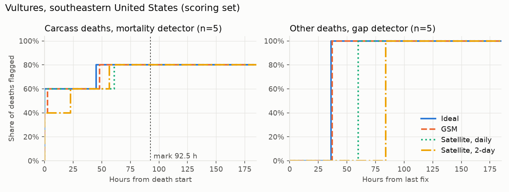
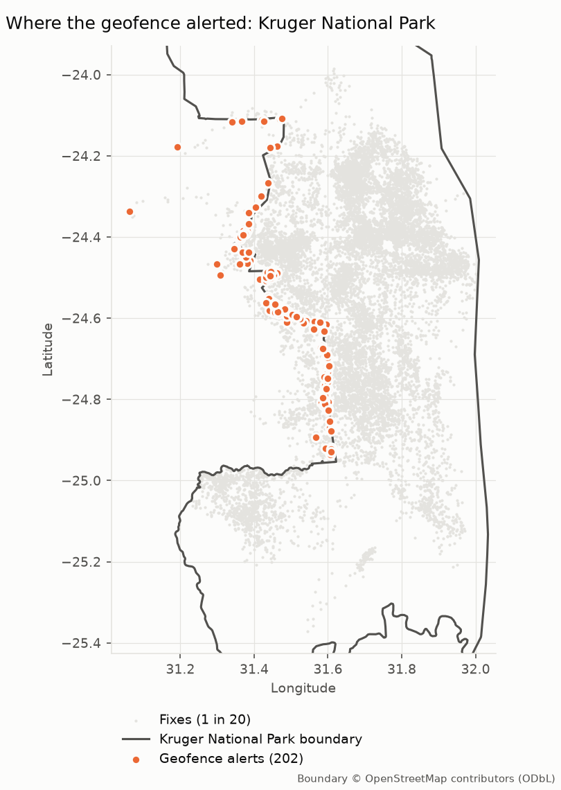
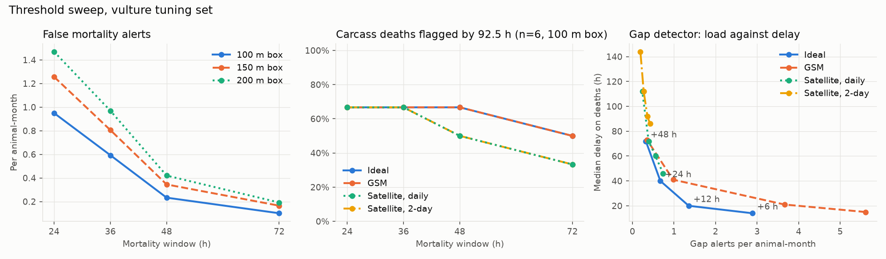

# Collar Telemetry
[](https://github.com/benmacp123/collar-telemetry/actions/workflows/main.yml)

An alerting pipeline for wildlife GPS collars. It turns raw, late and
duplicated fixes into alerts for possible deaths, silent collars, unusual
movement and park-boundary crossings, and is scored against real recorded
deaths in public Movebank data.

## The question

Can a small, cheap pipeline turn raw GPS-collar fixes into alerts a ranger
can trust, without drowning them in false alarms?

Protected-area teams receive collar fixes that arrive late, out of order,
twice or not at all. The useful product is not the data but the alert:
raised quickly, raised once, and right often enough to act on.

## The answer so far

**Every recorded death is caught, but most alerts are still false.** On
held-out vultures (23 deployments, 491 animal-months, 10 recorded deaths,
scored once after thresholds were frozen on an earlier set):

| | Ideal arrival | Daily satellite upload |
|---|---|---|
| Deaths that raised an alert | 10 of 10 | 10 of 10 |
| Carcasses flagged by the mortality detector within 92.5 h | 4 of 5 | 3 of 5 |
| Deaths with no carcass period (collar stops) flagged by the gap detector | 5 of 5, at 36 h | 5 of 5, at 60 h |
| All alerts per animal-month | 1.1 | 0.9 |
| Mortality alerts that were real deaths | 3% | 3% |
| "Potential death" alerts that were real deaths | 23% | 33% |

For a programme tracking 30 vultures that is about one alert a day. The
fast mortality alert is mostly vultures sitting still at a roost; the
"potential death" alert (still, then silent) is about ten times more
trustworthy but usually comes once a carcass collar stops reporting, so it
confirms a death rather than giving the first warning. Ten deaths is a
small sample, so these rates are indicative, not precise.



**Geofencing shows that the boundary matters as much as the detector.**
Using Kruger National Park's published boundary, 4 of 14 elephants raised
202 "left the park" alerts (0.7 per animal-month), every one on the
western edge. That edge borders the private reserves (Sabi Sand,
Timbavati), which share Kruger's open system with no fence between them,
so these are real crossings but not ones a ranger needs to hear about.
The animals stayed out for a median of 15 h, so this is not GPS jitter.
The fix is a better boundary, not a better detector: the detector takes
any polygon, so a park would load its own operational fence. Jackals
never left Etosha and raised no geofence alerts.



Full tables for every study and arrival scenario are in
[`results/evaluation/EVALUATION.md`](results/evaluation/EVALUATION.md).

**Status:** detection core (mortality, data gap, unusual movement,
geofence), local replay and evaluation complete. Cloud handlers built and
checked end to end against an AWS emulator (moto), with every incident
matching the replay. Terraform and the Lambda deployment package written
and validated in CI ([`infra/`](infra/README.md)); not yet deployed to AWS.

## How it works

All detection logic lives in a pure-Python core
([`src/telemetry/core/`](src/telemetry/core/)) with no AWS imports, so the
same code runs in the local replay runner (every result here) and in the
Lambda handlers ([`src/cloud/`](src/cloud/), the only code that imports
boto3). The rest of the package is the replay harness (`sim/`), data
loading (`data/`) and scoring and reporting (`analysis/`); a test keeps
each layer to its own imports.

- **Cleaning:** schema checks, de-duplication, a short hold that reorders
  late fixes, and a per-species speed filter for impossible jumps.
- **Detectors**, each with thresholds sourced in
  [`docs/ASSUMPTIONS.md`](docs/ASSUMPTIONS.md):
  - *mortality*: no movement beyond a 100 m box for a species window
    (36 h for vultures, past their 12-14 h overnight roost);
  - *data gap*: a collar silent through hours it is normally on (it
    learns each collar's duty cycle), after allowing for upload delay;
  - *unusual movement*: displacement far outside the animal's own recent
    baseline;
  - *geofence*: crossing any GeoJSON boundary, as an exit fence (a park)
    or a keep-out zone. Fixes within 100 m of the boundary are ignored and
    two fixes in a row confirm a crossing, so jitter along a fence line
    does not alert. Built on shapely, projected to metres locally.
- **Alert lifecycle:** one incident per episode, not one per fix; flaps
  reopen the same incident; resolves based on late fixes are flagged. A
  `potential_death` incident is raised while a mortality and a gap incident
  are open together.
- **Cloud runner:** a publisher cuts each collar's replay timeline into
  daily messages on an SQS FIFO queue (one message group per collar, so
  each collar's messages stay in order). A processor Lambda runs each
  message through the core and saves its state (compressed) to DynamoDB
  with a write conditional on the previous message's number, so a
  retried message changes nothing; a message that changes incidents saves
  them in the same transaction. A
  notifier Lambda reads the incidents table's stream and emails
  `potential_death` incidents through SNS: at least once, never lost to a
  crash between saving and sending. For live use, a scheduled clock
  Lambda (deployed disabled) ticks every collar so a silent one still
  raises its gap alert.
- **Arrival scenarios:** each study is replayed under four seeded upload
  patterns: ideal (every fix arrives as taken), GSM (hourly uploads, 10%
  of days out of coverage, retries and duplicates), and satellite uploads
  once a day or every other day. Detection delay is measured on the
  processing clock, so slow uploads show up in every number.

## How it was evaluated

- **Ground truth:** deployment end types from the Movebank reference data,
  plus deaths recorded only in comments ([`data/labels.csv`](data/labels.csv),
  each row quoting its evidence). Tracks that end stationary with no
  recorded death are reported apart as possible unrecorded deaths, not
  counted as false alarms.
- **Death start** (our definition): the earliest fix from which every
  later fix lies within 100 m of the track's final position. Deaths whose
  stationary period lasts at least 24 h (12 h for elephants) are scored on
  the mortality detector; the rest, where the collar stops within hours, on the gap
  detector from the last fix.
- **Held-out split:** thresholds were chosen only on vulture deployments
  starting before 2013 (hourly tags), with a sweep that shows the
  trade-off rather than a single tuned number
  ([`results/sweep/SWEEP.md`](results/sweep/SWEEP.md)). Deployments from 2013 on
  (mostly 1-3 minute tags) were scored once after the thresholds were
  frozen, which also tests whether they carry across fix rates. They did:
  false alarms were lower on the held-out set than on the tuning set.
- **Reference mark:** 92.5 h, the median time carcass collars in the
  tuning set kept reporting, so half are silent by then.



## Limitations

- **Small numbers.** 6 tuning and 5 held-out carcasses. The held-out set
  has been scored twice: once for the frozen thresholds and once, declared,
  for the potential-death alert, which has no tuned parameter.
- **Sparse carcass collars are the blind spot.** A collar on a carcass
  often sends few fixes; below six in the window the mortality detector
  cannot fire, and only the gap detector notices.
- **Death start depends on the radius.** At 200 m instead of 100 m the
  held-out rate by the mark falls from 4 of 5 to 3 of 5 (ideal) and 2 of 5
  (satellite).
- **Mammals are only partly tested.** The jackal and elephant tracks
  contain no carcass periods (jackal tracks stop at death; the elephants
  died after their collars stopped), so only their false-alarm rates and
  gap alerts are measured. Their mortality detection is scored on
  synthetic carcasses (`results/evaluation/EVALUATION.md`), which a
  30-day collar life makes easy to catch: every one is flagged, sparse
  ones included.

## Data

All three tracking studies are CC0 1.0, from the Movebank Data
Repository; full citations, file details and retrieval dates are in
[`data/SOURCES.md`](data/SOURCES.md).

- Vultures, southeastern United States: Kluever BM (2026),
  <https://doi.org/10.5441/001/1.666>. 57 deployments, 2006-2021, 27
  recorded deaths (two of them recorded only in comments).
- Black-backed jackal, Etosha National Park: Bellan SE, Getz WM (2017),
  <https://doi.org/10.5441/001/1.n1r7ds5r>. 22 deployments, 2009-2011.
- African elephant, Kruger National Park: Slotow R, Thaker M, Vanak AT
  (2019), <https://doi.org/10.5441/001/1.403h24q5>. 14 deployments,
  2007-2009.
- Park boundaries for Etosha and Kruger: © OpenStreetMap contributors,
  under the Open Database Licence (ODbL 1.0), relations 2982497 and
  1752987, in [`data/raw/boundaries/`](data/raw/boundaries/). Refreshed
  only by the optional `scripts/fetch_boundaries.py`; nothing else needs
  the network.

## Reproducing

Everything runs from committed files, with no accounts or keys. Needs
[uv](https://docs.astral.sh/uv/), which installs Python 3.14 (the Lambda
runtime's version) if it is missing; `uv.lock` pins every package, so
local runs, CI and the deploy zip get the same versions:

```
make install  # uv sync into venv/
source venv/bin/activate
make test lint format-check
make results  # replay every study and scenario, then score (about 5 min)
make sweep    # threshold sweep on the vulture tuning set (about 2 min)
make cloud-local  # handlers in Lambda containers on moto (Docker, ~6 min)
make cloud-moto   # every study through the handlers on in-process moto
```

`make help` lists every target. `make results` writes
`results/replay/<study>/<scenario>/summary.json`, the evaluation JSON,
[`results/evaluation/EVALUATION.md`](results/evaluation/EVALUATION.md) and
the figures; [`results/README.md`](results/README.md) says what each
output is. The held-out vulture set was first scored with
`PYTHONPATH=src python scripts/evaluate.py --score`; since then its
results are kept in every run. Runs are seeded and reproduce byte for
byte.

## Licence

Code, documentation and results are released under the MIT Licence; see
[`LICENSE`](LICENSE). The Movebank tracking data in `data/raw/` keeps its
original CC0 1.0 licence; please cite the studies listed above. The park
boundaries in `data/raw/boundaries/` are an
OpenStreetMap extract and stay under the ODbL 1.0, © OpenStreetMap
contributors; maps drawn from them carry that attribution.
